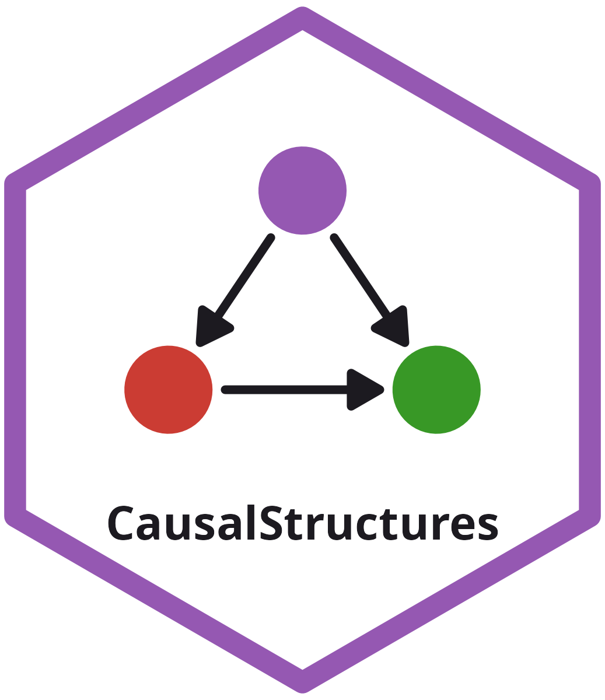

---
format:
  gfm:
    default-image-extension: ""
---

<!-- README.md is generated from README.qmd. Please edit that file -->

```{r}
#| label: setup
#| include: false

knitr::opts_chunk$set(
  collapse = TRUE,
  comment = "#>",
  fig.path = "man/figures/README-",
  dpi = 150
)
```

# CausalStructures <picture><source media="(prefers-color-scheme: dark)" srcset="man/figures/logo.png" /></picture>

<!-- badges: start -->
[](https://app.codecov.io/gh/BjarkeHautop/CausalStructures)
[](https://github.com/BjarkeHautop/CausalStructures/actions/workflows/R-CMD-check.yaml)
<!-- badges: end -->

CausalStructures is an R binding to the Julia package
[CausalStructures.jl](https://github.com/BjarkeHautop/CausalStructures.jl), for
representing, validating, and reasoning about causal graphs

## Installation

Install CausalStructures from GitHub:

```r
pak::pak("BjarkeHautop/CausalStructures")
```

CausalStructures calls a compiled library of the Julia package
CausalStructures.jl. Releases come with pre-built libraries for Linux, macOS and
Windows, so you don't need Julia:

```r
jlbind::install_library("CausalStructures", method = "download")
```

Or, with [Julia](https://julialang.org/install/) (\>= 1.13), build it yourself,
which takes a few minutes (and is needed for the development version):

```r
jlbind::install_library()
```

Either way, run it again after updating CausalStructures. A built library uses
the Julia that built it, so rerun `jlbind::install_library(force = TRUE)` if
that Julia is removed (e.g. by a `juliaup` update).

## Graph types

The following graph types are supported, shown here following the abstract type
hierarchy from CausalStructures.jl:

```
CausalGraph
├─ DAG            Directed Acyclic Graph
├─ UG             Undirected Graph
├─ AbstractPDAG   All Partially Directed Acyclic Graphs
│  ├─ PDAG        Partially Directed Acyclic Graph
│  ├─ CPDAG       Completed Partially Directed Acyclic Graph
│  └─ MPDAG       Maximally Oriented Partially Directed Acyclic Graph
├─ ADMG           Acyclic Directed Mixed Graph
├─ AbstractAG     All Ancestral Graphs
│  ├─ AG          Ancestral Graph
│  └─ MAG         Maximal Ancestral Graph
├─ PAG            Partial Ancestral Graph
└─ UNKNOWN        No structural constraints
```

Each graph class encodes structural constraints, such as no cycles, closed under
Meek's rules, etc., and these constraints are verified on construction.

## Example

First, we define a causal graph using the `cgraph()` function, giving its edges
and its class:

```{r}
#| label: load
#| message: false

library(CausalStructures)

dag <- cgraph("A --> X + Y, X --> M --> Y", class = "DAG")

# Alternatively, wrap the edges in %...%, and then not use a string:
cgraph(A %-->% X + Y, X %-->% M %-->% Y, class = "DAG")
```

You can then run a number of queries and transformations on the causal graph:

```{r}
#| label: queries

parents(dag, "Y")
adjustment_set(dag, "X", "Y")

cpdag <- dag_to_cpdag(dag)
cpdag
```

and plot it, here highlighting the treatment, the outcome and the adjustment
set:

```{r}
#| label: plot
#| fig-width: 6
#| fig-height: 2.5
#| fig-show: hide

cgraph_plot(dag) |>
  style_nodes(fill = "lightskyblue", nodes = c("X", "Y")) |>
  style_nodes(fill = "gold", nodes = adjustment_set(dag, "X", "Y"))
```

<!-- Linked by hand, as Quarto's GFM output drops the alt text of plots. -->


See the [documentation site](https://bjarkehautop.github.io/CausalStructures/)
for the full documentation.

## Multi-threading

Some algorithms (`all_backdoor_sets()`, `all_adjustment_sets()`,
`all_frontdoor_sets()`, `enumerate_dags()`, `count_dags()`, `enumerate_mags()`,
`pagcauses()`) can use multiple threads. To do so, set the `JULIA_NUM_THREADS`
environment variable (a number, or `"auto"` for one per core) *before* loading
the package, for example in your `.Renviron` file or with

```r
Sys.setenv(JULIA_NUM_THREADS = "4")
library(CausalStructures)
```
