# Plotting Causal Graphs

[`plot()`](https://rdrr.io/r/graphics/plot.default.html) draws a
`cgraph` with
[grid](https://stat.ethz.ch/R-manual/R-devel/library/grid/html/00Index.html)
graphics. For node placement, you can use the layered layout from
[Sugiyama.jl](https://github.com/BjarkeHautop/Sugiyama.jl), one of the
built-in layouts, or provide your own layout:

``` r

library(CausalStructures)
setup()
```

General-purpose by design

There are many conventions for drawing causal graphs. For example, you
might box conditioned variables, dash latent variables, draw `<->` as a
dashed arc, or use different colors for exposures and outcomes.

[`plot()`](https://rdrr.io/r/graphics/plot.default.html) does not impose
any of these conventions by default. Instead, you can use its styling
options, global defaults, and layouts to choose the conventions that
make sense for your application[^1].

## Basic usage

You can pass any `cgraph` to
[`plot()`](https://rdrr.io/r/graphics/plot.default.html), and all edge
marks are supported:

``` r

unknown <- cgraph("A <-> B o-> C o-- A", class = "UNKNOWN")
plot(unknown)
```

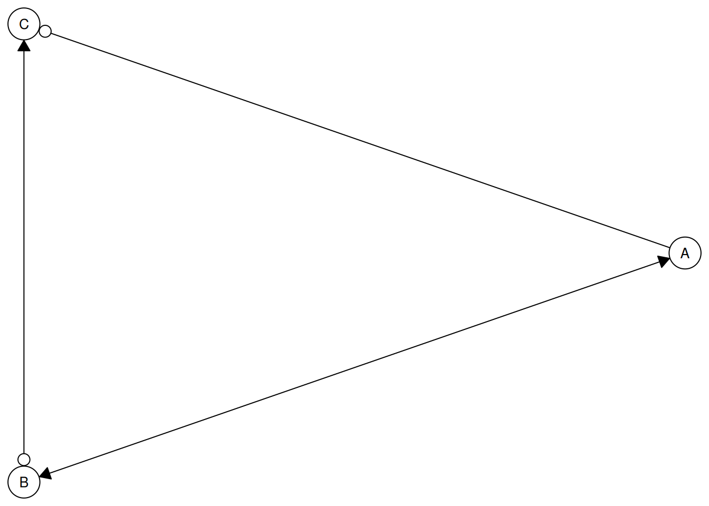

As an example, here is the DAG from Figure 6.5 of Peters, Janzing and
Schölkopf (2017):

``` r

dag <- cgraph(
  "C --> X, A --> X + K, X --> F + D, K --> Y, D --> Y + G, Y --> H"
)
plot(dag)
```


[`plot()`](https://rdrr.io/r/graphics/plot.default.html) draws the graph
right away and returns a `cgraph_plot` object invisibly. Printing it, or
passing it to [`plot()`](https://rdrr.io/r/graphics/plot.default.html)
again, redraws it, and its `grob` element is the grid grob, so you can
also draw it yourself with
[`grid::grid.draw()`](https://rdrr.io/r/grid/grid.draw.html):

``` r

p <- plot(dag)
```


``` r

class(p$grob)
#> [1] "gTree" "grob"  "gDesc"
```

There are four main areas of styling:

- **[Layout](#plot-layouts)**: where nodes are placed
- **[Styling nodes](#styling-nodes)**: node appearance
- **[Styling edges](#styling-edges)**: edge appearance
- **[Labels and titles](#labels-and-titles)**: text and annotations

If you want to set defaults for an entire project, you can use
[`plot_options()`](https://bjarkehautop.github.io/CausalStructures/reference/plot_options.md).
Arguments passed to
[`plot()`](https://rdrr.io/r/graphics/plot.default.html) still take
precedence, and `plot_options(plot_default_options())` resets to the
built-in defaults:

``` r

plot_options(node_style = list(fill = "lightblue"), edge_style = list(lwd = 2))
```

Per-node and per-edge styling

Every field in `node_style` and `edge_style` applies to all nodes or
edges. `node_style$by_node` and `edge_style$by_edge` override fields for
specific nodes and edges, which otherwise keep the global value:

``` r

plot(
  dag,
  node_style = list(by_node = list(Y = list(fill = "lightskyblue"))),
  edge_style = list(
    col = "gray60",
    by_edge = list(K = list(Y = list(col = "#DC143C")))
  )
)
```

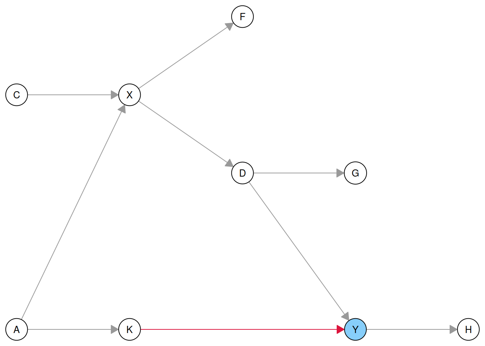

Only `Y` is filled blue; the other nodes keep the default white. The
`K --> Y` edge is crimson, and the global `col` turns every other edge
gray. The sections below list the fields each style list accepts.

## Layout

The `layout` argument controls where the nodes are placed. It defaults
to `"sugiyama"` for a `DAG`, and to `"stress"` otherwise.

``` r

plot(dag, layout = "stress")
```

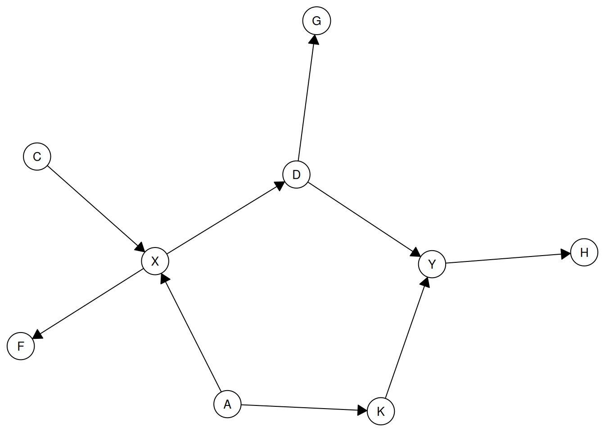

You can use these names for the built-in layouts. `"sugiyama"` comes
from [Sugiyama.jl](https://github.com/BjarkeHautop/Sugiyama.jl), while
the others are implemented in R; see
[`?cgraph_layout`](https://bjarkehautop.github.io/CausalStructures/reference/cgraph_layout.md)
for details:

| `layout`       | Algorithm                       |
|----------------|---------------------------------|
| `"sugiyama"`   | Sugiyama (layered) layout       |
| `"stress"`     | Stress majorization             |
| `"shell"`      | Nodes evenly spaced on a circle |
| `"squaregrid"` | Square grid                     |

For `"sugiyama"`, `direction` (`"right"`, the default, `"down"`, `"up"`,
or `"left"`) sets which way the layers flow:

``` r

plot(dag, direction = "down")
```

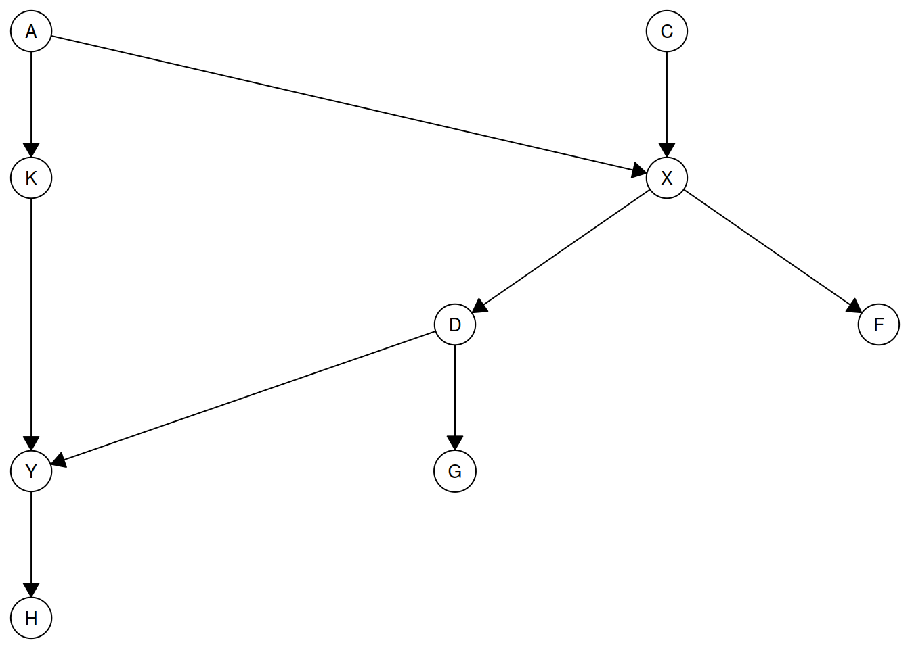

If you want to place the nodes yourself, you can pass explicit positions
instead of a name. You can either use a named list of `c(x, y)` pairs
keyed by node name, or a `data.frame` with `name`, `x`, and `y` columns:

``` r

plot(
  dag,
  layout = list(
    A = c(0, 1),
    C = c(0, -1),
    K = c(1, 1),
    X = c(1, -1),
    D = c(2, -1),
    F = c(2, -2),
    Y = c(3, 0),
    G = c(3, 1),
    H = c(4, 0)
  )
)
```

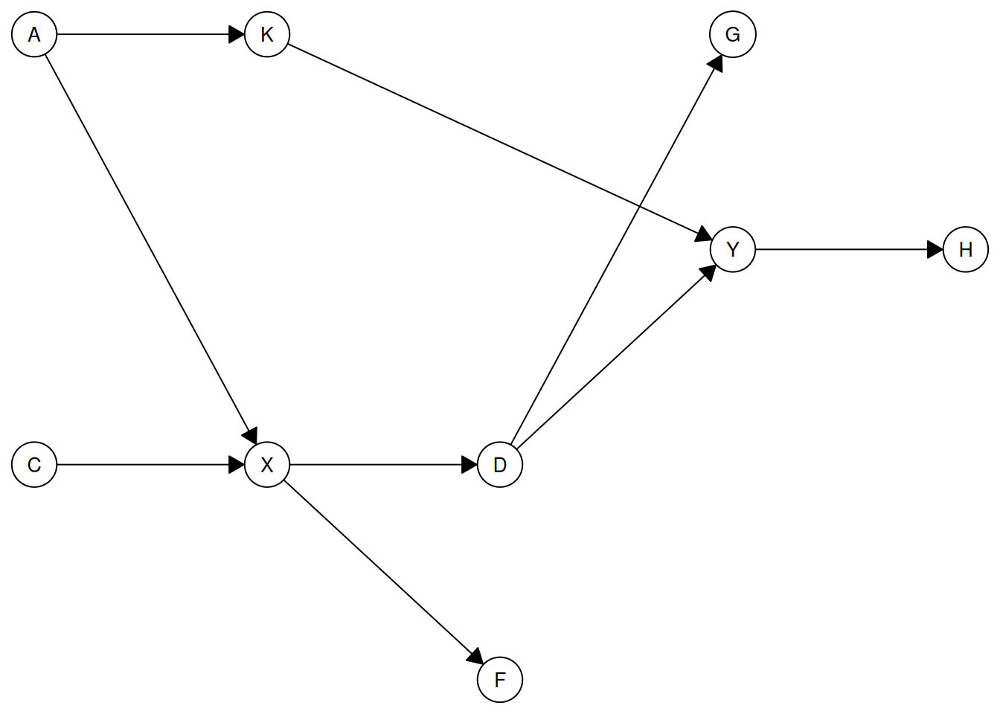

Tweaking a layout by hand

You can compute a starting layout using
[`cgraph_layout()`](https://bjarkehautop.github.io/CausalStructures/reference/cgraph_layout.md),
and then manually adjust a few nodes:

``` r

positions <- cgraph_layout(dag, method = "stress")
positions[positions$name == "G", c("x", "y")] <- c(1, 1.5)
plot(dag, layout = positions)
```

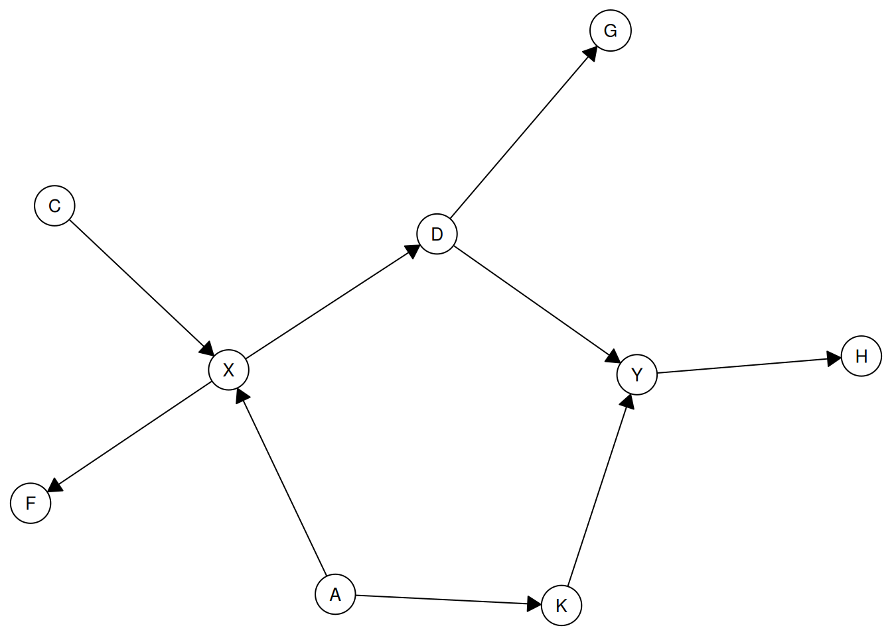

Sugiyama positions without Sugiyama routing

Sugiyama.jl implements its own routing using dummy nodes. If you prefer
the automatic Bezier-curve routing used by
[`plot()`](https://rdrr.io/r/graphics/plot.default.html), you can
compute the Sugiyama positions with
[`cgraph_layout()`](https://bjarkehautop.github.io/CausalStructures/reference/cgraph_layout.md)
and pass those instead:

``` r

dag_layered <- cgraph("A --> X, A --> B, X --> Y, B --> Y, A --> Y")
plot(dag_layered, layout = cgraph_layout(dag_layered, "sugiyama"))
```

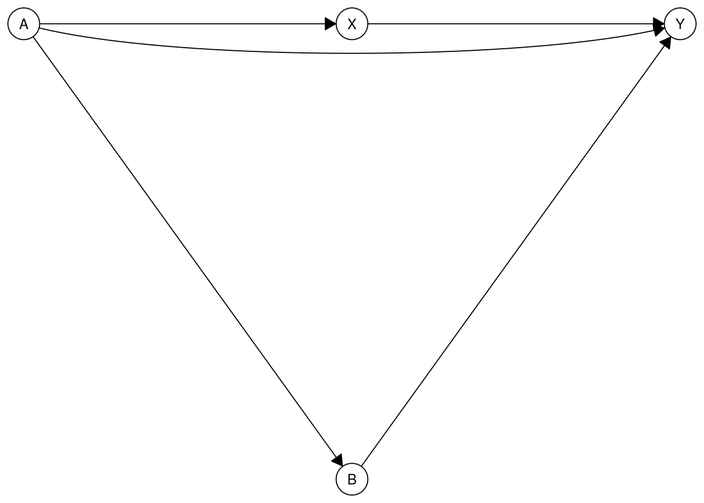

## Styling nodes

`node_style$by_node` is a named list of per-node overrides, keyed by
node name.

| Field | Default | Controls |
|----|----|----|
| `fill` | `"white"` | fill color |
| `col` | `"black"` | border color |
| `lwd` | `1` | border line width |
| `linestyle` | solid | border line style (any `lty`) |
| `shape` | `"circle"` | node outline shape |
| `radius` | `NULL` (text-fit) | size of each node (mm) |
| `padding` | `2` | clearance (mm) around each label when `radius` is `NULL` |
| `size` | `1` | multiplier on the computed node size |

Combine color, border, and shape to highlight a node:

``` r

plot(
  dag,
  node_style = list(
    fill = "lightblue",
    col = "navy",
    by_node = list(
      A = list(fill = "salmon", col = "#DC143C"),
      K = list(shape = "square")
    )
  )
)
```

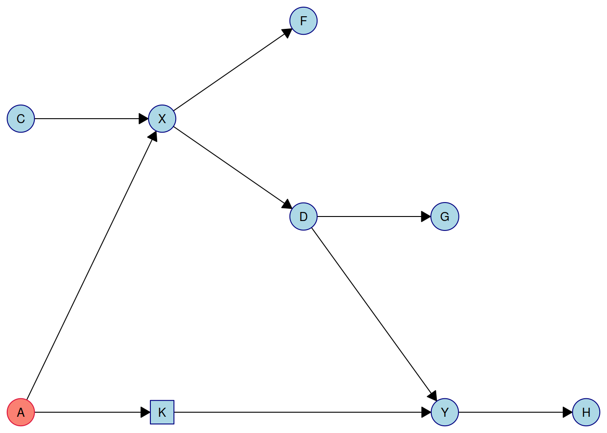

You can set `shape` to `"circle"` (the default), `"square"`,
`"ellipse"`, or `"rect"`. The latter two are mainly useful when you want
to fit an oblong label. You can also use `linestyle` to style the
border, for example to mark a latent variable:

``` r

plot(
  dag,
  node_style = list(
    by_node = list(X = list(linestyle = "dashed", col = "gray50"))
  )
)
```


If you only want to draw the node names, you can make the fill and the
border transparent. Edges still stop at the (now invisible) node
boundary, so you can use `"rect"` with a smaller `padding` to bring the
arrowheads closer to the text:

``` r

plot(
  dag,
  node_style = list(
    fill = "transparent",
    col = "transparent",
    shape = "rect",
    padding = 1
  )
)
```

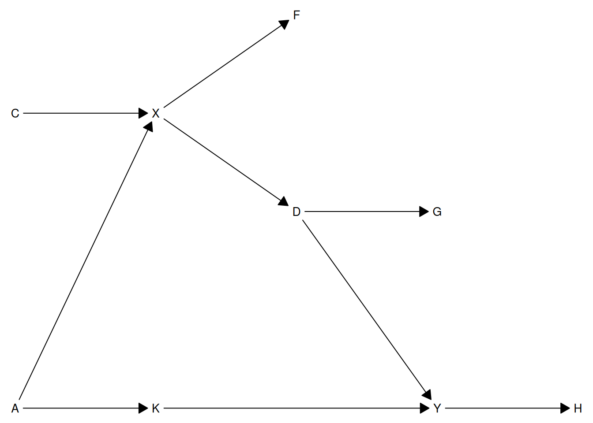

### Text-fit node sizing

By default (`radius = NULL`), nodes are sized to fit their labels:

``` r

longlabels <- cgraph("Exposure --> Mediator --> Y_outcome")
plot(
  longlabels,
  node_style = list(by_node = list(Exposure = list(shape = "ellipse")))
)
```

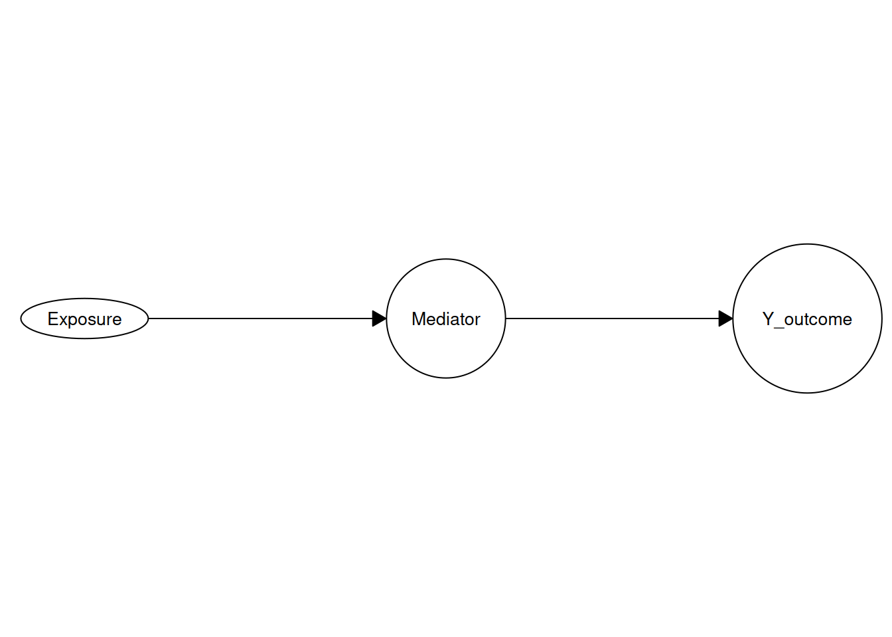

If you want to control the size yourself, you can set `radius`
explicitly:

``` r

plot(dag, node_style = list(radius = 6))
```

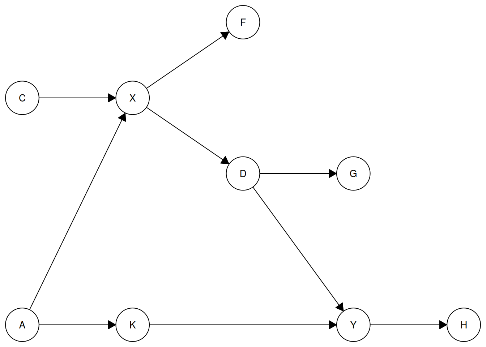

## Styling edges

`edge_style` can override its global fields at the following levels,
checked in this order:

1.  one exact edge: a `.by_type` entry under a node pair in `by_edge`,
    keyed by the edge’s notation, e.g.
    `by_edge = list(X = list(Y = list(.by_type = list("<->" = ...))))`
2.  a node pair in `by_edge` (`by_edge[[src]][[dst]]`), in either order
3.  a node in `by_edge` (`by_edge[[node]]`), for every edge touching it
4.  an edge-type sub-list (`directed`, `undirected`, `bidirected`,
    `partially_directed`, `partially_undirected`, `partial`)
5.  the global fields of `edge_style`

| Field | Default | Controls |
|----|----|----|
| `col` | `"black"` | line / marker color |
| `fill` | `NULL` (the edge’s `col`) | arrowhead fill color |
| `lwd` | `1` | line width |
| `lty` | solid | line style |
| `gap` | `0` | gap (mm) at edge ends |
| `curvature` | `NULL` | how far the edge bows |
| `path` | `NULL` | explicit waypoints for an edge’s route |
| `arrow_size` | `3` | length (mm) of arrowhead triangles |
| `circle_size` | `1.5` | radius (mm) of open-circle (`o`) endpoints |

Let’s style some edges by type:

``` r

admg <- cgraph("X --> Y, X <-> Z, Z --> Y", class = "ADMG")

plot(
  admg,
  edge_style = list(
    directed = list(col = "steelblue"),
    bidirected = list(col = "#DC143C", lwd = 2.5)
  )
)
```

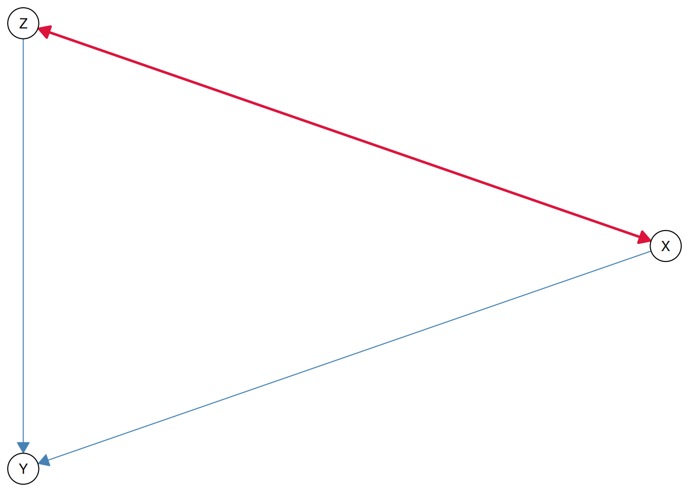

`fill` controls the arrowhead’s fill color. By default (`NULL`), it uses
the edge’s resolved `col`, so arrowheads are solid. If you want hollow,
outline-only arrowheads, pass `NA`:

``` r

plot(dag, edge_style = list(fill = NA))
```

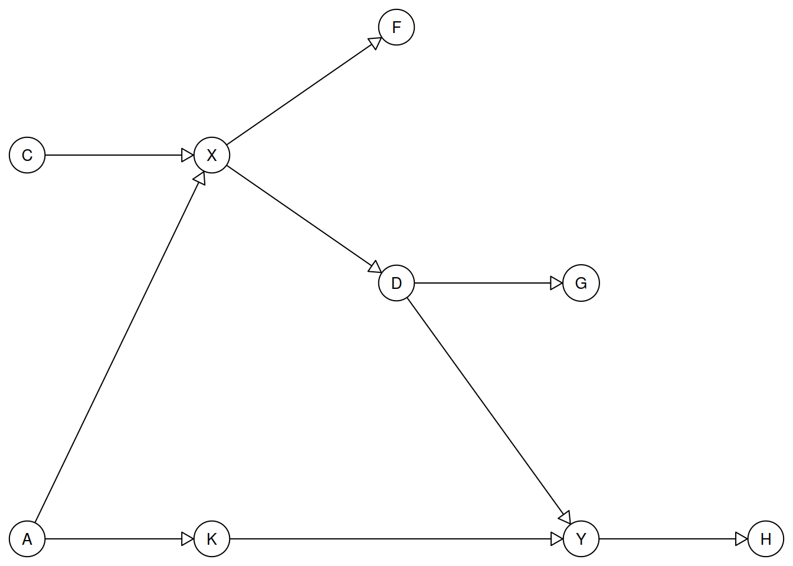

`lty` styles the edge line itself. For example, you can use it to dash
`<->` edges:

``` r

plot(admg, edge_style = list(bidirected = list(lty = "dashed")))
```

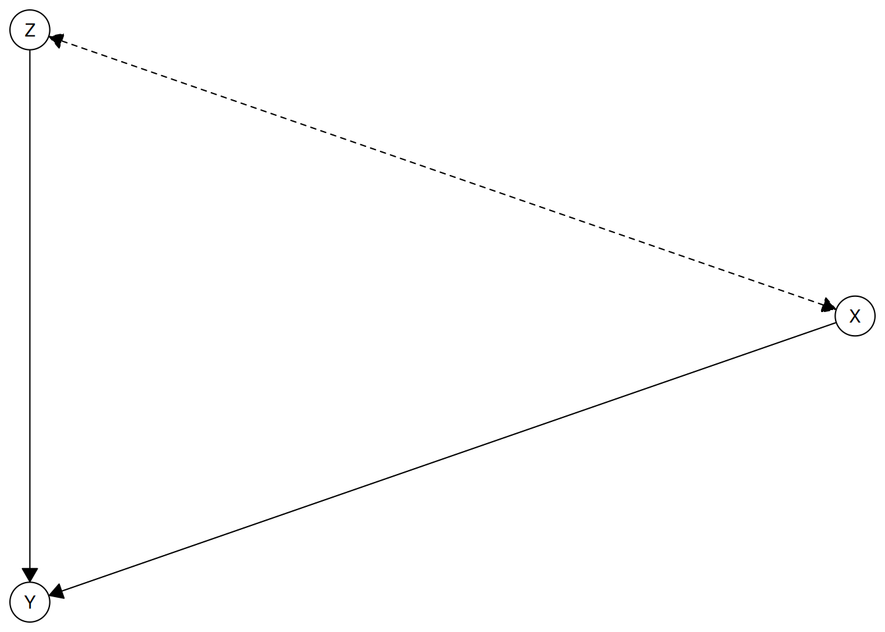

If you prefer some space between each end of an edge and the node
border, you can set `gap`:

``` r

plot(dag, edge_style = list(gap = 1))
```


### Targeting specific edges

If you want to change something for a specific edge, you can use a node
pair in `by_edge`:

``` r

plot(dag, edge_style = list(by_edge = list(A = list(X = list(col = "red")))))
```

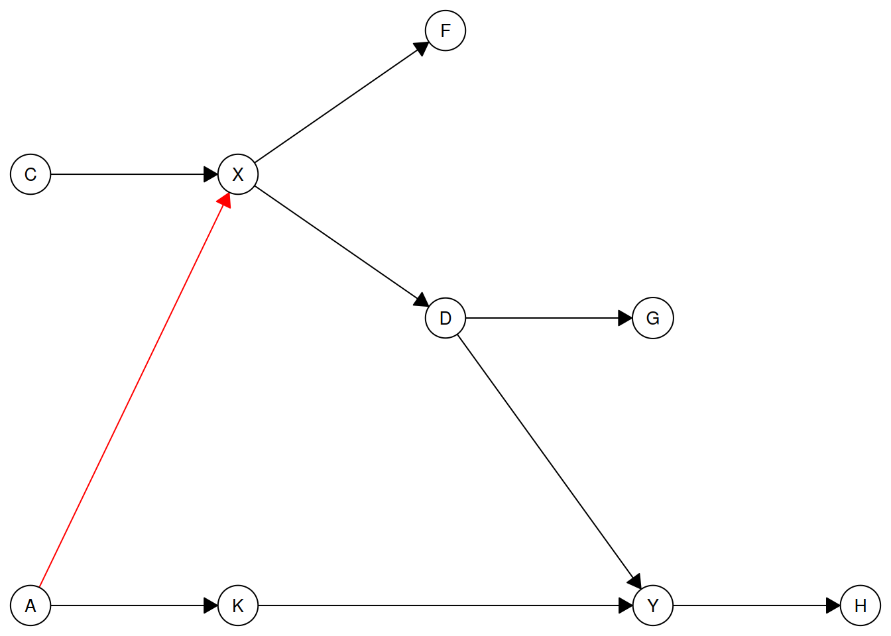

A node pair is unordered. This means that if an `ADMG` has both
`X --> Y` and `X <-> Y`, the pair applies to both edges. If you need to
distinguish them, add a `.by_type` entry instead:

``` r

shared <- cgraph("X --> Y, X <-> Y", class = "ADMG")

plot(
  shared,
  edge_style = list(
    col = "steelblue",
    by_edge = list(
      X = list(Y = list(.by_type = list("<->" = list(col = "#DC143C"))))
    )
  )
)
```

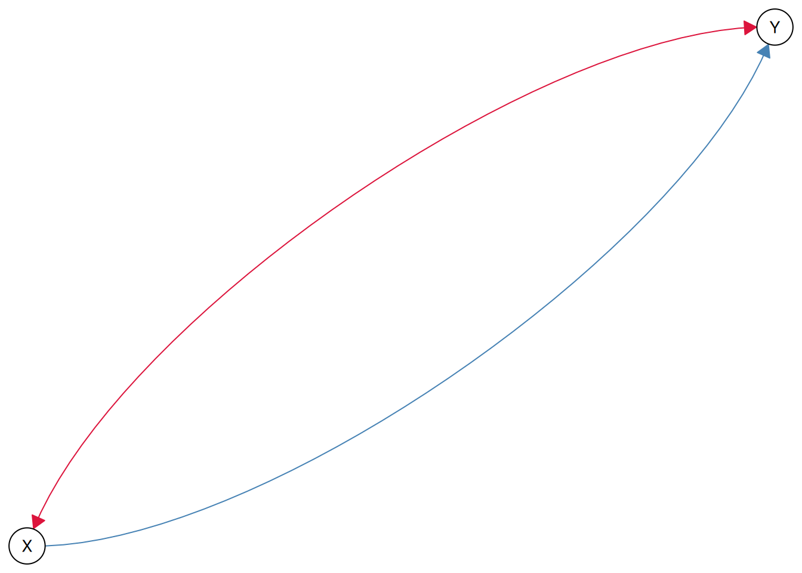

Symmetric edges

For symmetric edges, the order does not matter, so `by_edge$Y$X` with
`"<->"` is the same key as `by_edge$X$Y` with `"<->"`.

Notice that the two edges between `X` and `Y` are automatically curved
apart, so they don’t overlap.

### Curvature and automatic routing

`curvature` bows an edge into an arc instead of drawing it straight.
Positive values bow the edge to the left when travelling from `src` to
`dst`, while negative values bow it to the right.

``` r

plot(admg, edge_style = list(bidirected = list(curvature = -0.3)))
```

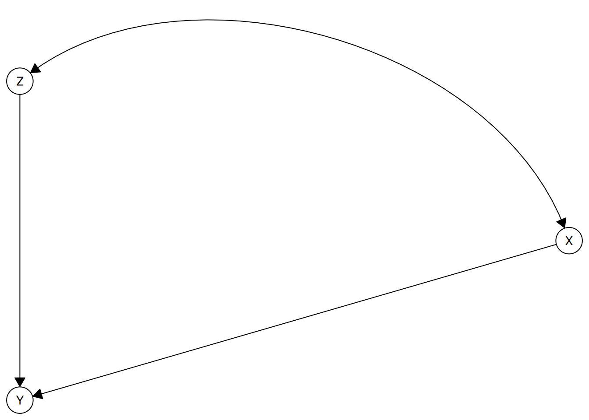

If a straight `src --> dst` edge would pass too close to a non-incident
node, [`plot()`](https://rdrr.io/r/graphics/plot.default.html)
automatically bends it around that node with a Bezier curve. Edges with
nothing in the way are always drawn straight.

``` r

detour <- cgraph("A --> X + Y, X --> Y")

plot(detour, layout = list(A = c(0, 0), X = c(1, 0), Y = c(2, 0)))
```

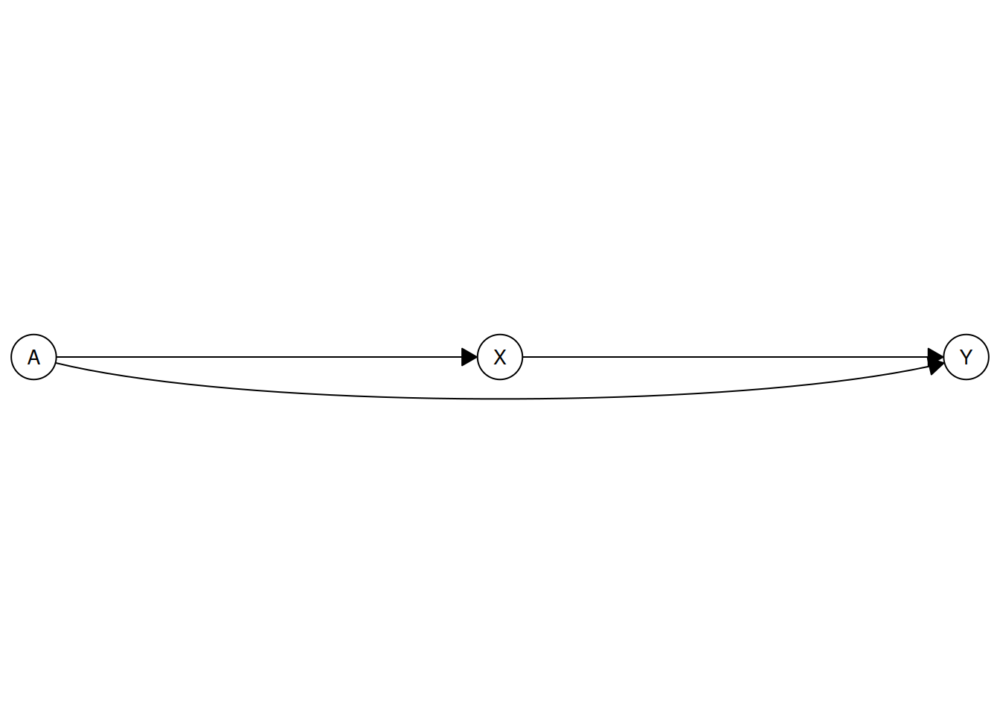

If you want to disable this automatic routing for a particular edge, you
can set its `curvature` to `0`:

``` r

plot(
  detour,
  layout = list(A = c(0, 0), X = c(1, 0), Y = c(2, 0)),
  edge_style = list(by_edge = list(A = list(Y = list(curvature = 0))))
)
```

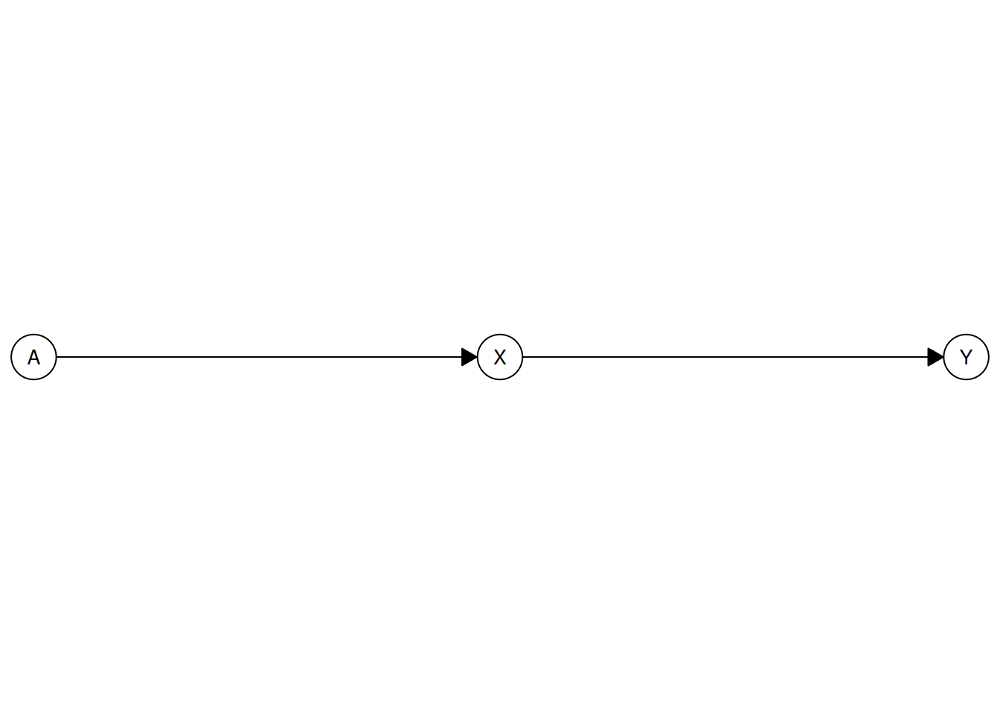

### Explicit edge paths

Edges are normally drawn as straight lines unless automatic routing is
needed. If you want to control the path yourself, you can set `path` and
provide intermediate points for the edge, in the coordinates of the
layout. For example, the edge `K --> Y` below is drawn through the point
`(0.5, -0.25)`:

``` r

positions <- cgraph_layout(dag, method = "stress")

plot(
  dag,
  layout = positions,
  edge_style = list(by_edge = list(K = list(Y = list(path = c(0.5, -0.25)))))
)
```

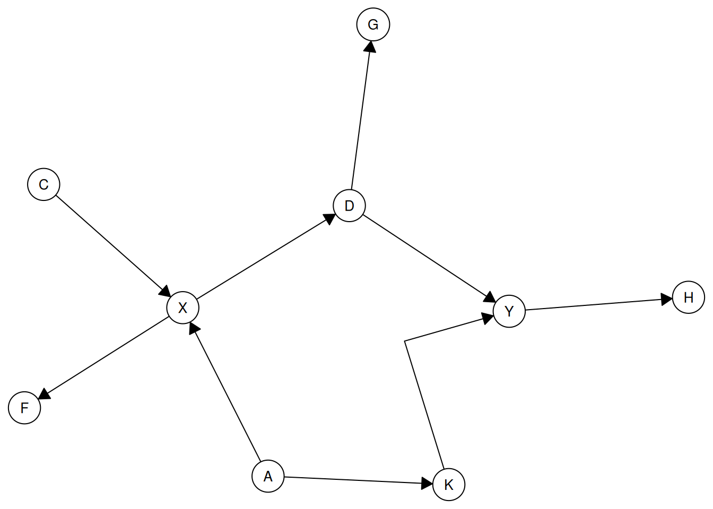

## Labels and titles

### Labels

`label_style$by_node` overrides the node label fields per node, like
[node styling](#styling-nodes).

| Argument / field         | Default   | Controls                |
|--------------------------|-----------|-------------------------|
| `labels`                 | `NULL`    | text drawn in each node |
| `label_style$col`        | `"black"` | node label text color   |
| `label_style$fontsize`   | `10`      | node label font size    |
| `label_style$fontface`   | `"plain"` | node label font face    |
| `label_style$fontfamily` | `""`      | node label font family  |

By default, each node is labelled with its own name. If you want
different labels, you can set them with `labels`. Node sizing takes
multi-line labels into account, so the nodes grow to fit:

``` r

plot(
  cgraph("A0 --> L1 --> A1 --> Y, A0 --> Y + A1"),
  labels = c(
    A0 = "Treatment\nat baseline",
    L1 = "Confounder\nat time 1",
    A1 = "Treatment\nat time 1"
  )
)
```

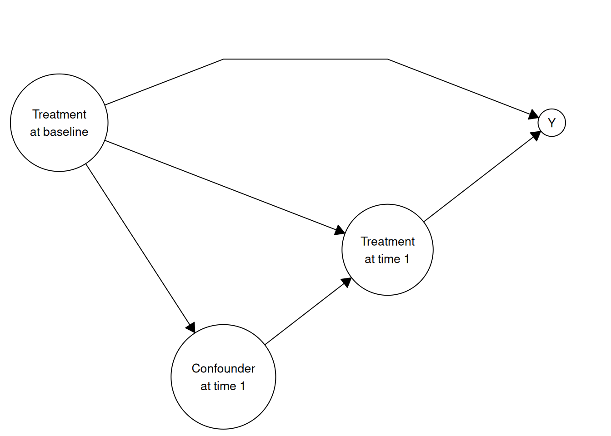

You can use `col` and `fontsize` to style the label text:

``` r

plot(
  dag,
  label_style = list(fontsize = 13, by_node = list(A = list(col = "#DC143C")))
)
```

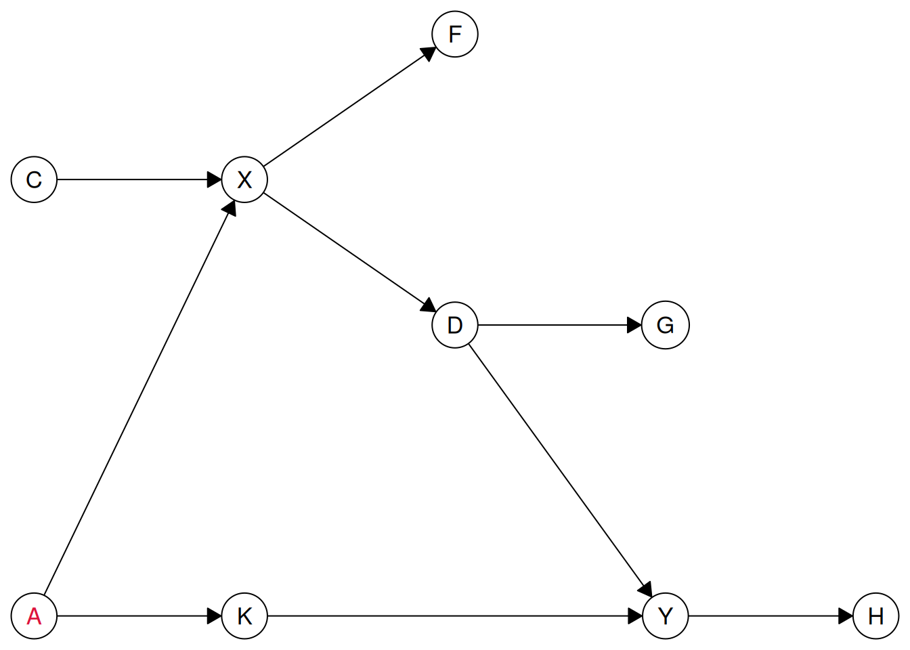

### Edge labels

Edge label fields are part of `edge_style`, so they use the same levels
as [edge styling](#styling-edges).

| Field | Default | Controls |
|----|----|----|
| `label` | `NULL` | text drawn along the edge |
| `label_col` | `"black"` | edge label text color |
| `label_fontsize` | `9` | edge label font size |
| `label_fontface` | `"plain"` | edge label font face |
| `label_fontfamily` | `""` | edge label font family |
| `label_shift` | `0.5` | position along the edge, 0 (source) to 1 (destination) |
| `label_distance` | `NULL` | perpendicular gap (mm) from the edge; `NULL` scales with `label_fontsize` |
| `label_rotation` | `NULL` | text angle in degrees; `NULL` follows the edge’s own angle |

Let’s add a label to the edge `K --> Y`:

``` r

plot(
  dag,
  edge_style = list(by_edge = list(K = list(Y = list(label = "hello"))))
)
```


By default, the label follows the edge’s angle. You can use
`label_shift` and `label_distance` to move it along or away from the
edge:

``` r

plot(
  dag,
  edge_style = list(
    label_shift = 0.75,
    label_distance = 4,
    by_edge = list(K = list(Y = list(label = "hi")))
  )
)
```


If an edge is steep or curved, following its angle can make the label
hard to read. You can use `label_rotation` to give it a fixed angle
instead:

``` r

plot(
  dag,
  edge_style = list(
    by_edge = list(
      A = list(
        X = list(
          label = "steep",
          label_rotation = 0,
          label_distance = 6,
          label_col = "#DC143C"
        )
      ),
      K = list(Y = list(label = "follows"))
    )
  )
)
```

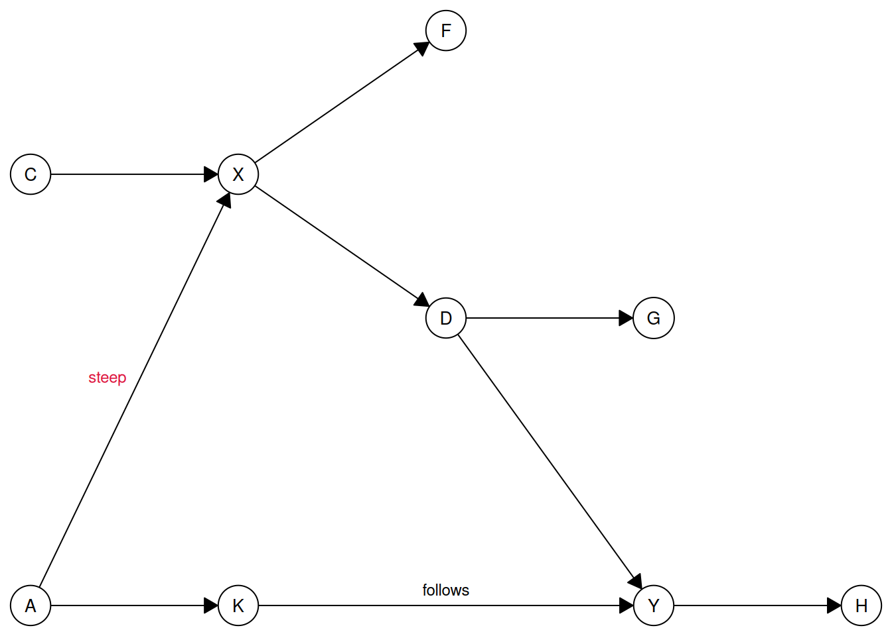

### Titles

| Argument / field | Default | Controls |
|----|----|----|
| `main` | `NULL` | plot title; `NULL` means no title |
| `title_style$fontsize` | `14` | title font size |
| `title_style$col` | `"black"` | title color |
| `title_style$fontface` | `"bold"` | title font face |
| `title_gap` | `grid::unit(1, "lines")` | gap between the title and the graph |

If you want to add a title, set `main`:

``` r

plot(dag, main = "My DAG", title_style = list(fontsize = 20, col = "navy"))
```

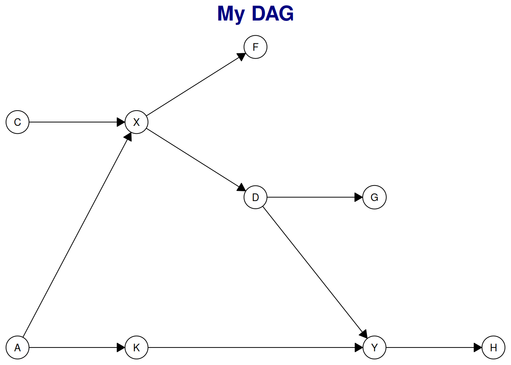

## Figure size and margins

| Argument | Default | Controls |
|----|----|----|
| `outer_margin` | `grid::unit(2, "mm")` | padding around the whole plot |
| `asp` | `NA` | y/x aspect ratio of the layout; `NA` fills the available space |

[`plot()`](https://rdrr.io/r/graphics/plot.default.html) draws into
whatever graphics device is open, so the figure size is set the usual R
way, e.g. with `grDevices::png(width =, height =)` or a chunk’s
`fig-width`/`fig-height`. Let’s make the figure a bit larger:

``` r

plot(dag)
```

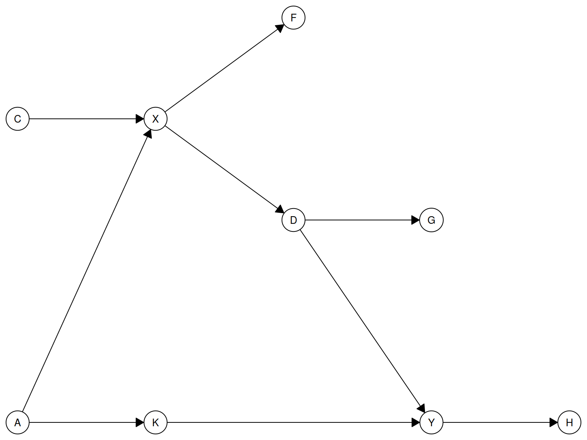

Figure 1

Large graphs need a bigger figure

The default figure size works well for small examples. As your graph
gets larger, labels and edges can become cramped or overlap. Increase
the figure size (and, if needed, `node_style$radius` or
`label_style$fontsize`) to keep larger graphs readable.

Uneven figure sizes and asp

By default, node positions are stretched to fill the figure, which can
distort the layout’s own proportions in an uneven figure. If you want to
keep them instead, set `asp = 1`.

## Composing into an existing figure

So far we’ve only used
[`plot()`](https://rdrr.io/r/graphics/plot.default.html) on its own
page. If you already have a grid viewport (for example, as one panel of
a larger figure), you can use `plot(cg, newpage = FALSE)` to draw the
graph there instead.

Let’s use this to draw the DAG and the ADMG side by side in one figure:

``` r

grid::grid.newpage()
grid::pushViewport(grid::viewport(layout = grid::grid.layout(1, 2)))
grid::pushViewport(grid::viewport(layout.pos.col = 1))
plot(dag, newpage = FALSE)
grid::popViewport()
grid::pushViewport(grid::viewport(layout.pos.col = 2))
plot(admg, newpage = FALSE, node_style = list(fill = "salmon"))
grid::popViewport()
```

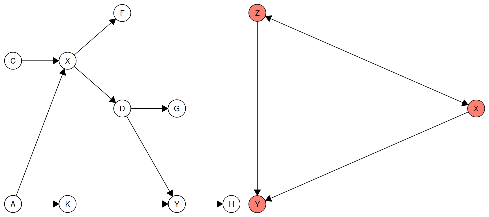

## Combining options

Here we combine some of the styling options above to plot a PAG:

``` r

pag <- cgraph(
  "C o-> X, D --> G + Y, X --> D + F, Y --> H, K o-> X, K --> Y",
  class = "PAG"
)

plot(
  pag,
  layout = "stress",
  node_style = list(
    fill = "whitesmoke",
    col = "slategray",
    by_node = list(
      X = list(fill = "skyblue", col = "royalblue"),
      Y = list(fill = "gold", col = "darkorange"),
      K = list(shape = "square", linestyle = "dashed")
    )
  ),
  edge_style = list(
    col = "darkslategray",
    partially_directed = list(col = "royalblue", lty = "dashed"),
    by_edge = list(
      K = list(Y = list(curvature = 0.3), X = list(label = "cool"))
    )
  ),
  label_style = list(
    by_node = list(X = list(col = "navy"), Y = list(col = "saddlebrown"))
  ),
  main = "A cool PAG",
  title_style = list(fontsize = 18, col = "navy")
)
```

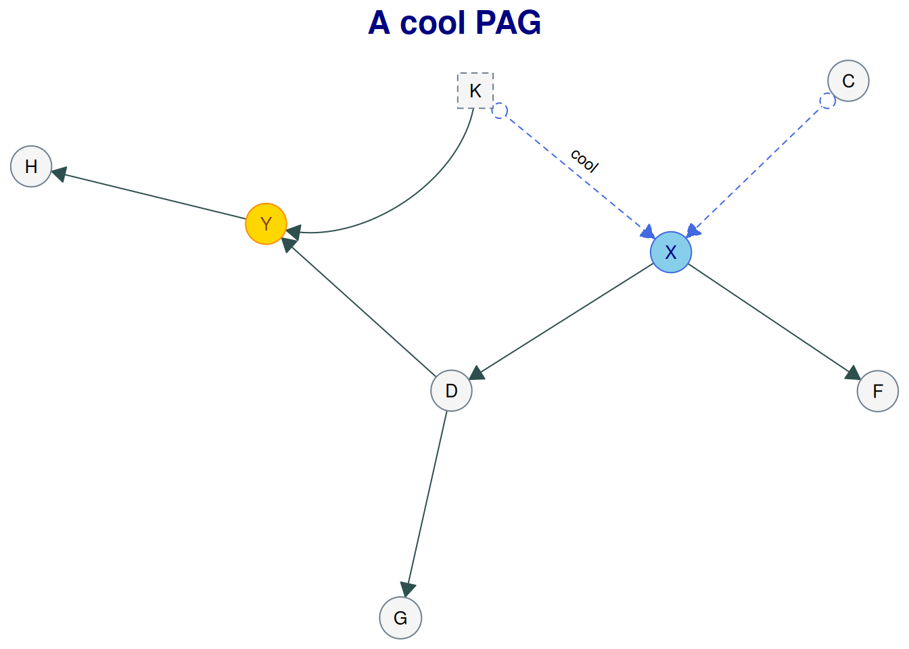

[^1]: [`plot_options()`](https://bjarkehautop.github.io/CausalStructures/reference/plot_options.md)
    presets for common conventions are also welcome as PRs!
